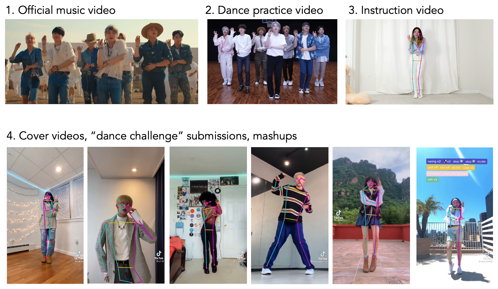
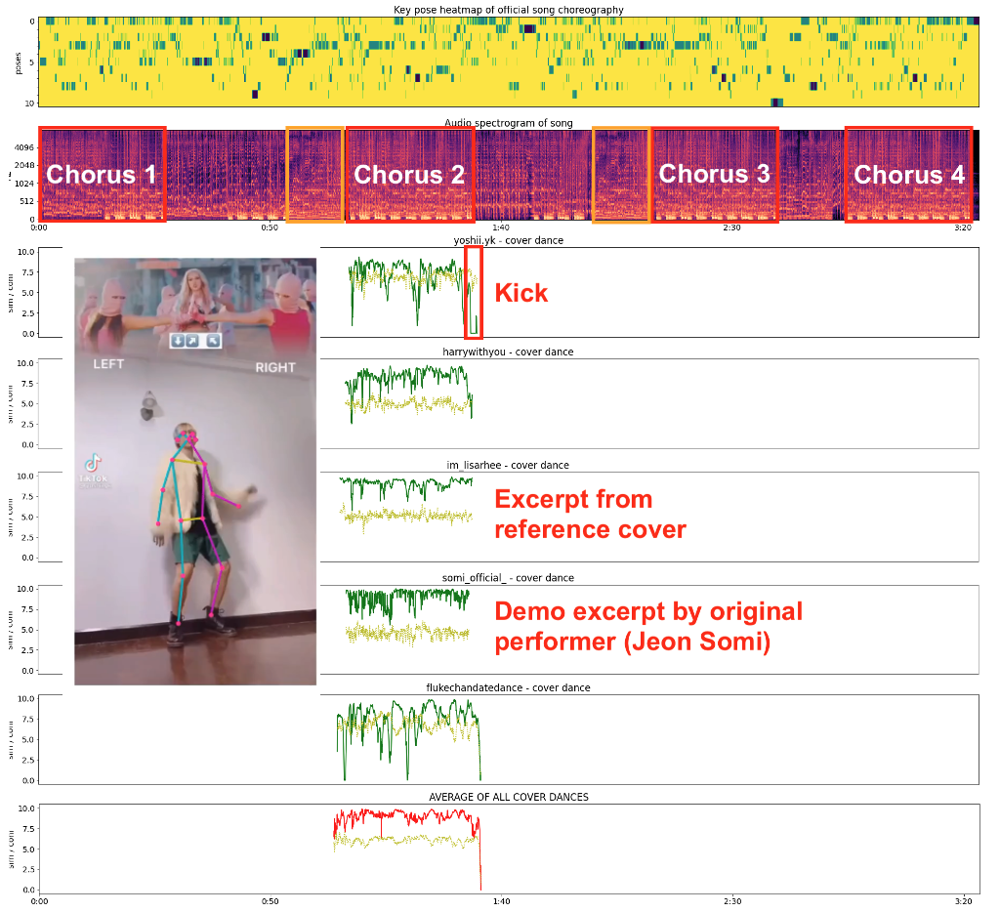
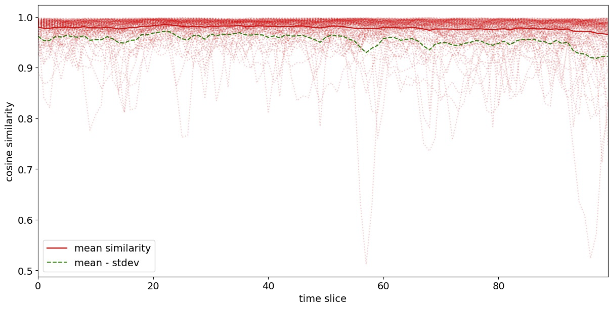
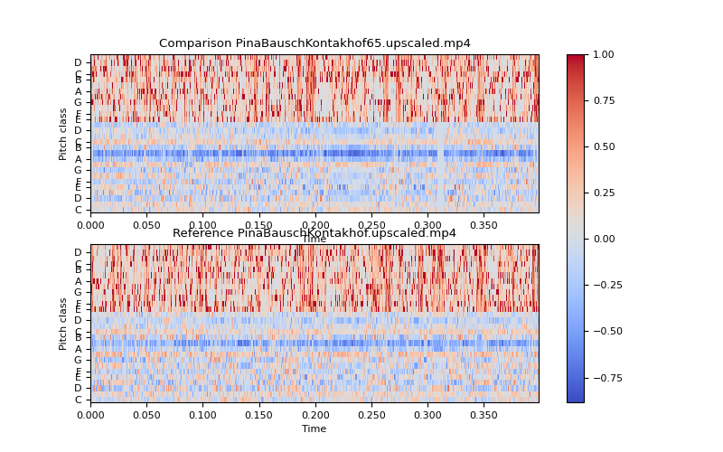
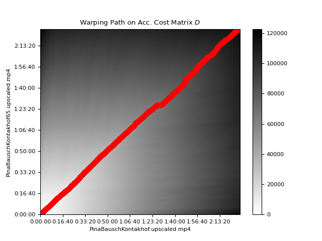
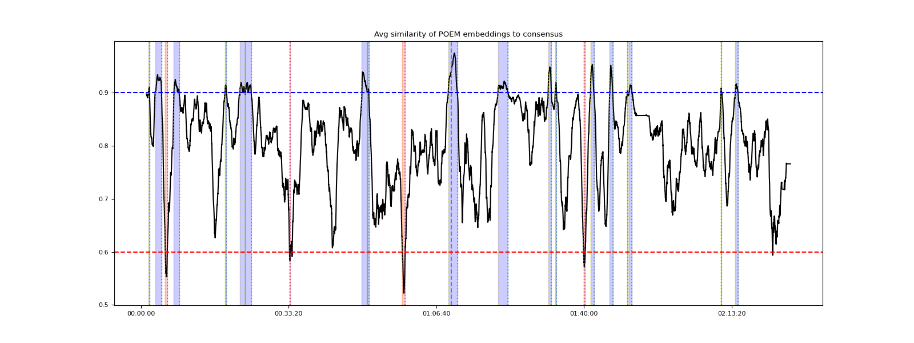

# Reworking Similarity and Consensus in Pose-Based Analyses of Theater Recordings

<!-- .slide: data-background-video="assets/K_K65_excerpt_silent.mp4" -->
<!-- .slide: data-background-size="contain" -->
<!-- .slide: data-background-video-loop -->
<!-- .slide: class="main-title" -->

:::
Talk abstract:
Advances in pose tracking, action recognition and gesture detection for "in-the-wild" monocular videos continue to improve the precision and consistency of such data inferred from recordings of theater performances. An initial focus of the MIME (Machine Intelligence for Motion Exegesis) project, building upon related work in dance and other cultural forms, involved examining notions of directorial and actorly style via derived motion statistics and embeddings of pose and action characteristics across a corpus of full-length theater recordings. This seminar will review work done so far and present further applications of these methods in analytical and archival contexts. One of the subsequent inquiries involves distilling a "consensus form" of different stagings of the same work by consolidating and averaging pose and action profiles across multiple renditions, aligned in whole or in part via accompanying modalities such as audio and text. Examining a performance's points of conformity to and deviation from the consensus can lead to new insights regarding its influences and the details of its staging. Another approach considers how notions of the similarity of poses, actions and gestures are operationalized and deployed at scale across archives of performances. The efforts to be detailed in the seminar prioritize supporting diverse search algorithms and strategies (such as similarity to a contemporaneous example, to an historical archetype, or to a sketch), generous visual and text-based exploration interfaces, and the maximum practicable degree of flexility regarding search parameters, models, and feature importance.

Thanks to Giacomo and Prof. Clarisse for inviting and hosting us. We're excited to be part of this seminar series and to contribute to the discussions that are happening today and tomorrow.

The "Reworking" in the title of this talk indicates that we're considering theatrical works of drama and dance (including opera) that (like nearly all such works) are restaged and reperformed in different ways over time. It also references that we're revisiting prior research work on this topic that we pursued in the past, but largely dropped in favor of our distant/narrow-viewing investigation into pose-related indicators of directorial style. We're returning to it now, equipped with more tools for computational humanities/cultural analytics analyses.

---

## The Team

 Michael Rau

 Peter Broadwell

 Simon Wiles

 Vijoy Abraham

:::

Thank you for joining us today.

---

## ➡️ &nbsp; Materials, Inspiration: Stagings and Interpretations <!-- .element: class="fragment custom order-of-sections" -->

## ➡️ &nbsp; Theoretical Frameworks for Similarity and Consensus <!-- .element: class="fragment custom order-of-sections" -->

## ➡️ &nbsp; Methods: Alignment and Pose Estimation <!-- .element: class="fragment custom order-of-sections" -->

## ➡️ &nbsp; Analyses and Some Findings <!-- .element: class="fragment custom order-of-sections" -->

## ➡️ &nbsp; Implications, Further Work <!-- .element: class="fragment custom order-of-sections" -->

<!-- .slide: class="order-of-sections" -->

:::

---

## Materials, Inspiration

<!-- .slide: data-transition="slide-in fade-out" -->

:::
As mentioned, our previous work involves using computer vision algorithms to precisely detect actor poses for every frame of an archival theatrical production. Our methodology runs pose detection on numerous videos, generating hundreds of thousands of poses, then sifts through that data to draw meaningful conclusions. Our work doesn't just focus on one meaningful pose or tableaux but instead seeks to understand the aggregate effect of all poses throughout a production, and across multiple productions by different directors, and in the case of the work we'll focus on today, multiple productions of the same work at different times, usually (but not necessarily) by different directors and performers.

In addition to bringing us closer to identifying the director's contribution to pose in theater, this approach enables us to think about aesthetics as systemic practice, not just “great moments.”

!!! (from PB - not sure this is all that useful, or if it will just be lost in the merge, but I figured I'd leave it here for now)
But conversely, considering multiple performances of the same work allows us to examine notions of "great moments" and particularly to approach the question of whether certain moments, or aspects of those moments (or of the work more broadly), such as pose and motion, are held more "constant" and are subject to less variation and reinterpretation across a work's history of performances than other elements of the work. Might this lower degree of variation suggest that these elements constitute the core "essence" of the work, at least across a particular time period? And therefore the other elements of the work are less essential? And what might a "distant" view of the essential elements of a work look like?

---

## Materials, Inspiration

<!-- .slide: data-transition="fade-in slide-out" -->

:::
By leveraging pose estimation and action recognition, we can quantify theatrical performance aspects previously left to subjective interpretation. We analyze not just individual poses, but movement patterns, spatial relationships between performers, and production rhythm and flow. We can use pose analysis to distinguish between different directors' work, regardless of actors, text, or designers, getting closer to understanding specific directorial contributions. Moreover, looking at pose through MIME allows to examine a performance in a way that is shareable (across scholars, artists and archivists), reviewable (we can all point at the same segment/metric), debatable (people can now contest what the metric means). I see our work as making a methodological contribution to theatre studies, by building an evidence object that sits between the video footage, the actual performance itself, and the prose.

---

# Theoretical Frameworks for Similarity and Consensus

:::

!!! This is where we'd discuss theoretical frameworks and concepts: "tradition dominants" and "consensus form" from folklore, "cultural attractor theory" from psychology/social science.

PB: I'm not sure whether there's really a need to delve very far into folkloristic theory here, but we can name-drop some concepts.

Definition of folklore (Tangherlini et al.): Informal cultural expressive forms circulating over time on and across social networks. 

Full-length works of theater and dance are not "informal" and typically must be considered from a great distance (e.g., as a plot summary) or excerpted to work within the rather constrained analytical scope of most folkloristic methods. But there's still interpretive value in considering the process of adapting such works as a folkloric phenomenon, especially given that interpretations/stagings (as well as the performers) do "circulate" within creative social networks (as recordings, as recollections and reviews) and influence subsequent performances.

Another assumption from folklore theory and practice that doesn't necessarily hold here is that storytellers/informants comprise a close homogeneous group -- which probably is only partially true for creative networks in theater. Under this assumption, Swedish ethnologist Albert Eskeröd asserted in the mid 20th century that over repeated tellings of stories, "tradition dominants" emerge, encompassing shared beliefs and perspectives (Årets äring: etnologiska studier i skördens och julens tro och sed, _The Year's Crop: Ethnological Research into Traditions at Harvest-time and Christmas_, 1947). 

Twentieth-century ethnological practice also recognized that folklore emerges from the dialectic tension between individuals and tradition (Charles W. Chesnutt, "Superstitions and Folklore of the South", 1901). While individuals try to push the boundaries of what may be acceptable to the group, tradition is conservative, and exerts a cultural force that aims toward consensus. Through this process of give and take, a folkloric form such as a legend comes to act, in the words of Timothy Tangherlini as "a symbolic representation of folk belief and collective experiences, and serves as a reaffirmation of commonly held values within the tradition group." (Timothy R. Tangherlini, _Interpreting Legend: Danish Storytellers and Their Repertoires_, 1994). 

!!! MR to discuss Cultural Attractor Theory -- if desired.

Peter now will discuss some prior work that proved to be relevant, and to describe our methodology.

---

## Choreographic Transmission and Variation on Social Media

:::
Previous work considering the social media dance challenges that exploded in popularity during the COVID-19 pandemic.

Here we have a pretty direct folkloric analog, albeit one in which slavish devotion to the source form of the dance is highly rewarded, as the challenges can be more technical/athletic in nature than interpretive. Yet some interpretation and individual boundary-pushing does appear (and can be rewarded in its own way).

---

## Choreographic Transmission and Variation on Social Media

:::
K-pop!

One evocative way of visualizing the consensus in these single-dancer works is just to synthesize an animated or photorealistic (deepfake) avatar performing the average of all synchronized dances. This was fairly difficult to do well when we began the research (and the results of doing this kind of thing badly with human forms can be pretty groteseque). But nowadays it's not so difficult. We might even consider how to visualize the sections at which the variation is greater, perhaps as transparent variant "ghosts" overlaid on the conservative average poses. But for the moment this is "future work."

---

## Choreographic Transmission and Variation on Social Media

:::
Distant viewing results (for a fairly small corpus of 143 single-dancer performances of 10 challenges).

Corpus: 10 TikTok dance challenges, 5-20 cover dances per challenge = 133 single-dancer TikTok covers + 10 demonstration videos 

Correlation (Pearson’s) of cover/demonstration pose similarity vs. motion in cover dance -- r: .04, p: 5.56e-39 – significant but very weak.

---

# Performance Invariance

:::
A performance work is, operationally, what persists across its re-performances. Performers, costumes, tempo, historical moment, audience and individual choices all change. Whatever survives that churn is the invariant. 

Richard Schechner has a wide quoted definition of performance that it is ""twice-behaved behavior."  The invariants idea tries to put numbers on that definition: what, exactly, is the "twice" repeating?

We see new strands forming: . 1. Who is dancing? This is stylometry and attribution: identify the dancer, the director, the style.
2. What is the dance? This is invariance and transmission: identify what survives across bodies.

---

# Methods

---

## Temporal-Convolutional vs. Transformer Models

 <strong>Open PifPaf</strong>  Temporal-convolutional 2D only, limited tracking

 <strong>PHALP</strong> (pose) + <strong>WiLoR</strong> (hands) Transformers-based 3D, more robust to occlusion

:::
As Michael mentioned, this project works with moving images recorded on standard 2D "monocular" cameras. This opens up basically the entire history of theater on film for analysis, but it can be quite challenging to get sufficient accurate pose data from such "in the wild" live stage or studio recordings, due to multiple camera angles, panning, cuts, occlusion, shadows and so forth.

The first convolutional neural network-based pose estimation tools, such as OpenPose circa 2018, were revolutionary, but even after some further refinements, they still really struggled with in-the-wild videos such as the example shown on the left and are even more limited at estimating 3D coordinates and tracking multiple people in a shot.

As sometimes happens during this current era of AI research, a better model came along just in time, with a new generation of transformer-based models for computer vision, and more specifically via some great software tools for pose estimation and tracking from a research group at UC Berkeley.

---

## The Models Continue to Improve

 <strong>Meta's SAM 3D Body</strong>  Infers "Momentum Human Rig" (HMR) - rigid skeletons and volumetric meshes

:::
The reward for procrastination -- eventually a better model comes along. This is from a demo of Meta's Segment Anything 3D Body model, which was released a few months ago. The base model only works on still images, but there are already open-source projects that have adapted it to run on videos. It incorporates two models, a rigid skeleton model and a deformable mesh, which are inferred semi-independently. The model was trained on multi-camera recordings, improving its ability to infer what can't be seen from a single (monocular) camera. It also does a better job than previous models of matching hands and feet (though it's still not perfect at that) and supports a greater variety of body types.

---

## PHALP: Predicting Human Appearance, Location and Pose

Jathushan Rajasegaran, Georgios Pavlakos, Angjoo Kanazawa, Jitendra Malik. “Tracking People by Predicting 3D Appearance, Location & Pose.” arxiv.org/abs/2112.04477 (2021).  
https://github.com/broadwell/PHALP

:::
The most important of the tools we used extensively, however, is a bit older, and it's named PHALP -- you can see the acronym there. It achieved state-of-the-art accuracy in pose estimation a few years ago (and is still the best for video) by interweaving the tasks of estimating human forms while also noting their appearance (that is, by extracting texture maps of their clothing and such) and tracking their trajectories over time in an estimated 3D space. This enables the transformer-based system to fill in occluded limbs and even entire poses that earlier models would "lose track of" for multiple frames before finding them again.

---

## LART: Lagrangian Action Recognition with Tracking

Jathushan Rajasegaran, Georgios Pavlakos, Angjoo Kanazawa, Christoph Feichtenhofer, Jitendra Malik. “On the Benefits of 3D Pose and Tracking for Human Action Recognition.” arxiv.org/abs/2304.01199 (2023).  
https://github.com/broadwell/LART

:::
We augmented the 3D pose data from PHALP with a customized action recognition tool built by the same team, named Lagrangian Action Recognition with Transformers. This software also produces a 60-element vector in the AVA "Atomic Visual Actions" embedding space to describe every detected action inferred for every pose in every frame.

---

## Probabilistic View-Invariant (2D+) Pose Embeddings

Sun, Jennifer J, Jiaping Zhao, Liang-Chieh Chen, Florian Schroff, Hartwig Adam and Ting Liu. “View-Invariant Probabilistic Embedding for Human Pose.” In Proceedings of the European Conference on Computer Vision, Springer, 2020, pp. 53-70.  
https://sites.google.com/view/pr-vipe

:::
Finally we adopted another embedding, this one from Google and CalTech, that projects the 2D coordinates of a pose into a 16-dimension space that situates poses closer together if they are probably similar in their actual 3D representations. Note that we also get the estimated 3D coordinates of the poses from PHALP, but as we'll see later, sometimes this probabilistic embedding is more useful for analysis.

---

## MIME: Machine Intelligence for Motion Exegesis

### Processing Pipeline

<ul style="margin-top:2rem">
  <li><strong style="font-size:2rem">Inference Tasks</strong>
    <ul>
      <li>Pose Estimation (PHALP/4D-Humans)</li>
      <li>Action Estimation (LART)</li>
      <li>View-Invariant Embeddings (Pr-VIPE)</li>
      <li>Shot Detection (TransNetV2)</li> <!-- .element: class="fragment" -->
      <li>Face Recognition (ArcFace/DeepFace)</li> <!-- .element: class="fragment" -->
      <li>Hand Estimation (WiLoR)</li> <!-- .element: class="fragment" -->
    </ul><!-- .element: class="fragment" -->
  </li>

  <li style="margin-top:2rem"><strong style="font-size:2rem">Coordination Steps</strong>
    <ul>
      <li>coordination of hands and poses, calculating joint angles</li>
      <li>segmentation into movelets with in-place and sidereal motion</li><!-- .element: class="fragment" -->
      <li>calculation of pose and action interest, synchronous motion</li><!-- .element: class="fragment" -->
      <li>pregeneration of pose and face clusters</li><!-- .element: class="fragment" -->
    </ul> <!-- .element: class="fragment" -->
  </li><!-- .element: class="fragment" -->
</ul> <!-- .element: class="fragment" -->

:::

The pipeline is first and foremost about running the inference tasks.

In addition to the three core technologies that Peter already introduced our ingestion pipeline can also optionally perform Shot-Detection, Face Recognition, and Hand Estimation,

and once we have all this information we also need to perform a number of coordination tasks

these are tasks that are adjacent to the primary AI/ML inference tasks and which supplement and augment the raw pose estimation data.

---

# Interfaces

:::
We don't have time for a live demonstration today, so instead I'll very quickly share some screenshots from some of the interface affordances we have available.

---

<!-- .slide: data-transition="slide-in fade-out"-->

:::
This is a timeline view for a single performance that lets us see how our data are distributed along a temporal axis.

---

<!-- .slide: data-transition="fade" -->

:::
This is our first iteration of a search interface that allows searching for similar poses or actions.

---

<!-- .slide: data-transition="fade" -->

:::
Here is a full view of a single frame.

---

<!-- .slide: data-transition="fade" -->

:::
We have face clustering plotted along a time axis.

---

<!-- .slide: data-transition="fade" -->

:::
These images illustrate how the PHALP software infers depth from monocular inputs. The visualization on the left is actually from a different model (MoGe = Monocular Geometry) that we chose because it looks cooler, but the two models use broadly similar deep learning-based approaches.

---

<!-- .slide: data-transition="fade" -->

:::
This is an interactive 2D UMAP projection of poses clustered with the HDBSCAN algorithm.

We're using the visualization code here from pixplot, but the clustering and the projection are based not on the images but on the vector space that represents our pose estimation inference vectors.

---

<!-- .slide: data-transition="fade" -->

:::
Searching for a source pose from one recording across a corpus of recordings...

---

<!-- .slide: data-transition="fade-in slide-out" -->

:::
And finally here's yours truly performing a pose in front of a webcam and using that to search for poses.

Michael's now going to show us some of the ways he's been able to make use of these affordances in his work.

---

# Analyses and Some Findings

---

## Recurring Poses and Thematic Pose Analysis

<video data-autoplay controls muted src="assets/Bausch4.mp4"></video>

:::
Using MIME's timeline, we can easily analyze a production in terms of repetetive gestures. Pina Bausch is famous for her use of repetition. There's a popular quote often attritubed to Pina Bausch that "Repetition is not repetition... The same action makes you feel something completely different by the end." A researcher can simply select a specific pose in the production, and the timeline will show where else the pose shows up in the performance. You can jump easily to those spots in the performance, or you use it chart certain thematic recurrances. The timeline view gives you a distant view of the performance, where you can see chart entrances and exits of performers, and as get a sense of some aspects rhythmic or thematic elements by noting what repeats within the performance and when.

---

## Delsarte, Denishawn: When Expressive Components are Systematized

Ted Shawn: "Nobody Knows  the Trouble I've Seen" from his  _Four Dances Based on  American Folk Music_ in 1938

Davon Rainey:  "Nobody Knows"  in 2016

:::
Previously, we considered early footage of Ted Shawn (1891-1972), the American choreographer and dancer who started the Denishawn School with his wife Ruth St. Denis, which was strongly influenced by the work of Francois Delsarte (1811-1871). They went on to influence many strains of modern american dance, and in recent years there's been a revival of interest in Shawn's work, as well as some remountings (reworkings?) of his dances.

---

## Delsarte, Denishawn: When Expressive Components are Systematized

Plots of the prevalences of the Shawn/Delsarte "Reflection" pose archetype  in the two dance recordings from the previous slide

:::

---

##

<!-- .slide: data-background-video="assets/Shawn_Nobody_Knows_stacked.mp4" -->
<!-- .slide: data-background-size="contain" -->
<!-- .slide: data-background-video-loop -->
<!-- .slide: class="main-title" -->

:::

---

## Direct Comparison: Multiple Directors' Stagings of the Same Work

 Michael Hampe

 Romeo Castellucci

 Erik Söderblom

:::

Zooming out from this close pose-related analysis and comparison of Shawn's choreography, we also compared stagings of a full-length theatrical work from seven different directors -- who in this case were all staging Mozart and Da Ponte's Don Giovanni from 1787.

The screenshots below show some pose estimation output from each of the directors' stagings -- note that in every case this is the same scene, from the finale of Act I.

---

## Direct Comparison: Multiple Directors' Stagings of the Same Work

 Sven-Eric Bechtolf

 Damiano Michieletto

 Jean-François Sivadier

:::
The table above gives derived statistics of the performances, highlighting entries with greater degrees of movement, distance between actors, and overall deviation from the average pose and actions. As the table is also ordered chronologically, it does seem to indicate a general tendency for performances to get more creative and/or "non-traditional" in their stagings over time, as quantified via pose and action estimation.

---

## Aligning Performances (by Music) to Get Average Pose "Consensus"

:::
Comparing the performances of Don Giovanni involved aligning all of them down to the sub-second level using the same pitch chroma/Dynamic Time Warping-based techniques previously applied to K-pop cover dances on TikTok
!!! at some point we'll discuss how we considered the variations in tempo among works that this approach deliberately irons out.
so that we could calculate the average poses and actions deployed at each moment of the opera -- in an attempt to find the choreographic "consensus performance" of this tradition. We also then computed the degree to which each director's staging deviates from this consensus at each moment, as part of our earlier study of directorial style.

As just mentioned, the easiest way to align the recordings, which only works because the work is an opera, was to extract the musical pitches heard at each timecode and apply the dynamic time warping algorithm to match the pitch chroma of different performances to compute a warping path that allows us to align them despite significant differences in tempo, non-musical action (e.g., intermission), and the occasional omission of certain scenes.

---

## Comparing Each Director's Staging to the "Consensus" Average

  
  

:::
As a final analytical output of the effort just described, we can plot the pose or motion similarities of each of the 7 performances to the average  "consensus" performance across the entire work (the dashed lines are scene and act boundaries). This is still a work in progress, but we can use this analysis to detect patterns such as certain scenes in which stagings are more likely to deviate from the consensus poses, and eventually use this to highlight automatically where directors might use especially distinctive poses and actions.

---

# A Closer Look: Kontakthof and Kontakthof 65

---

## Correlated motion in both performances

  
  

:::
The case we've been considering lately is kind of a mixture of the two we've presented so far: the performances to be considered are long-form and multi-performer, like the Don Giovanni corpus, but consist only of two performances, the first of which can be considered the "orginal," as with the Ted Shawn "Nobody Knows" recordings. Here we're looking at performances of Pina Bausch's Kontakthof; one is from a television broadcast of the original staging from 1978, and the second is from the production "With Ladies and Gentlemen over 65" first staged in 2000 in Wuppertal.

Here we can see an example of pose- and motion-related parallelism between these two performances. Just by flipping back and forth, we can see that the moments of greater synchronized motion (measured as the average correlation of in-place joint rotations per person on screen, observed approximately 6 times per second, then smoothed twice to get less jittery results) occur at roughly the same points in both performances. It also seems that the younger actors are a bit more synchronized, although the difference is small and could just be an artifact of the different recording conditions of the two performances.

---

## Align by Music (Pitch Chroma) and Poses?

  
  

:::
Considering this type of "Dance Theater" allowed us, and in fact encouraged us, to consider alternative methods of aligning performances and quantifying the "consensus" performance (in terms of pose/action/motion) and how and in which sections the two performances most conformed to or deviated from this consensus. Kontakthof contains a considerable amount of music, but there are also sections featuring fairly long silences or speech. An alignment system based entirely on musical pitches would miss any differences pacing between the two performances until the next shared musical section begins. So we ultimately decided on a system that combines the 12-pitch vector and the 16-element pose embedding of the person closest to the camera, after performing some normalization, at synchronized time slices between the video and audio, roughly 1/5 second.

We attempted to validate our choices of alignment vectors by cross-comparing with the averaged 60-element action embedding vectors for all people in the shot; if an alignment method based on musical pitches, pose embeddings of the person closest to the camera, averaged pose embeddings, or actual normalized pose coordinates, alone or merged together (and normalized or not), produces a smaller average difference between the average action embedding vectors for each pair of aligned frames, then it's probably a better alignment strategy. The strategy we chose did in fact produce the lowest average difference, but they were all so similar to each other (within one standard deviation) that we can't be sure there's any meaningful difference between them.

---

## Finding the "most similar" and "most different" sections

:::
Note that we applied some fairly generous smoothing to get these curves, averaging +/-5 seconds on either side of the current frame, so a segment that scores as highly invariant may nonetheless have sections of noticeable variation within it (and vice versa). Shortening the smoothing window will find increasingly smaller sections of exceptional variation or invariance. This choice (+/- 5 seconds) tended to produce the most interesting results.

---

## A most similar (invariant) section

<!-- .slide: data-background-video="assets/KH_invariant_1.mp4" -->
<!-- .slide: data-background-size="contain" -->
<!-- .slide: data-background-video-loop -->
<!-- .slide: class="main-title" -->

:::

---

## A most similar (invariant) section

<!-- .slide: data-background-video="assets/KH_invariant_2_dance.mp4" -->
<!-- .slide: data-background-size="contain" -->
<!-- .slide: data-background-video-loop -->
<!-- .slide: class="main-title" -->

:::

---

## A highly dissimilar (variant) section

<!-- .slide: data-background-video="assets/KH_variant.mp4" -->
<!-- .slide: data-background-size="contain" -->
<!-- .slide: data-background-video-loop -->
<!-- .slide: class="main-title" -->

:::

---

# Complications

:::
!!! How much of this to keep? Possibly modify?

In all applications using AI, it's important to acknowledge ethical considerations and limitations. Like all AI, there's danger in incorrect pose estimations and hallucination. Working with archival materials requires careful navigation—we've developed clear guidelines ensuring respectful, responsible use.

We must recognize the limitations of focusing solely on pose. Theater is multifaceted—pose is critical but represents only one thread in a rich tapestry including dialogue, set design, lighting, and sound. This analysis should complement, not replace, traditional artistic analysis methods.

This computational approach cannot definitively determine directorial intent. Observed patterns may stem from conscious choices, actor improvisations, or unintentional elements. These findings should serve as starting points for deeper investigations, not definitive conclusions.

The difficulty identifying gesture and motion. What we're looking for is, stable keyframes (distinctive poses), stable transitions (how you get between them), stable timing ratios (hold vs travel), stable spatial logic (path, plane, orientation)--and it's awfully hard to define those.

---

# Implications

:::
!!! MR possibly provide summary/closing thoughts, implications, further considerations

To return to the examples I started with, Bob Fosse shoulder rolls, or Brecht's silent scream are ways in which scholars use examples to illustrate an idea about a performer's work. However these depend on selective attention and "memorable moments".

pose-derived representations can expose the selectivity of critical description by contrasting salience vs prevalence.

Use pose similarity functions, to identify recurring poses, symmetry, and the rhythmic ebb and flow of staging. We can identify aggegrate stylistic elements that define a director's output, separating their unique contribution from performers' work or textual constraints. We can identify poses that make reference to historical movements and style and trace the evolution of a choreography. MIME also enables objective comparisons between different directors' interpretations, revealing new dimensions of artistic expression.

We can compare different directors' versions to show how physical expression and spatial storytelling evolve over time, across cultures, or in canonical works. Scholars could examine how themes or characters are represented physically—for instance, how kings are staged to show varying representations of power between productions.

This technology could chart how actors' physical choices evolve through rehearsals. Given the precision of the timeline view, we can correlate pose data with audience response—applause or laughter—to see which physical expressions elicit the strongest responses, deepening our understanding of audience engagement.

It creates an unprecedented record of a production's physical language. This “movement score” that is: shareable (across directors, academics, archivists), reviewable (you can point to the same extracted segment/metric), debatable (people can contest what the metric means). This is kind of evidence object that sits between video and prose. This is valuable for future research, teaching, or restaging. Beyond theater, this methodology could be adapted to film, opera, dance, and other movement-based arts. It could also apply to diverse fields from political speeches to sports biomechanics.

While this research presents exciting quantitative analysis possibilities, its true value lies in complementing traditional scholarly approaches. By integrating computational methods with human interpretation, we develop a more comprehensive understanding of theatrical performance and directorial style, enriching both academic discourse and artistic practice.

Thank you.

---

# Closing Thoughts

---

# Thank You&#x21;

---

# Appendix

---

# The MIME Platform

<section>

<svg class="spotlight" viewBox="0 0 1080 300" preserveAspectRatio="none">
  
  <defs>
    <mask id="spotlight-mask">
      <rect width="1080" height="300" fill="white" opacity=".6"/>
      <rect x="0" y="0" width="1080" height="300" fill="black"/>
    </mask>
  </defs>
  <rect width="1080" height="300" fill="#000" mask="url(#spotlight-mask)"/>
</svg>

:::

This diagram describes the platform architecture that delivers the flexibility we need

The whole thing is orchestrated with docker which makes maintaining it and working with it very convenient.

---

### Pipeline → Database → API Server → Interfaces

:::

So how do we operationalize these models and techniques?  How do we take the inferences and predictions they generate and make them useful for exploring our research questions?

The MIME platform consists of a modular ingestion pipeline, a database with sophisticated vector storage and indexing capabilities, an application and API server, and a collection of related interfaces that allow us to investigate, analyze, and visualize the data we have assembled.

The loosely-coupled nature of the platform allows us to iterate on steps somewhat independently and experiment with different approaches while still providing a consistent framework for our development.

---

## Database

* PostgreSQL / pgvector
* Multiple similarity metrics
* ANN Indexes (`IVFFlat`, `HNSW`)

## Application / API Server

* Machine-Learning dependencies
* Full Data-Science stack
* Jupyter Notebook server <!-- .element: class="fragment" -->
* FastAPI server <!-- .element: class="fragment" -->

<!-- .element: class="fragment" -->

:::

These inference and computational tasks are lengthy and expensive, so all the data generated are stored in our database server for subsequent retrieval and analysis.  For our vector storage and querying capabilities we're using pgvector which offers a number of affordances for the performant ANN searches on which much of the functionality is built.

The Application and API server is a container that has all our machine-learning dependencies available and its where all our machine learning and back-end code runs

The container is also home to a Jupyter Notebook server and a FastAPI server that exposes the endpoints that are consumed by our web interface

---

## Corpus Studies: Assembling Multiple Works per Director

:::
To address the question of what the data we extract from recordings via the MIME platform can tell us about how theater directors produce specific effects in their own personal style, we focused on three high-profile, contemporary "auteur" directors: Bill T. Jones, Romeo Castellucci, and Krzysztof Warlikowski, selecting 10 or 11 performances each has directed. We ran video recordings of these performances through the MIME pipeline without alteration, other than upscaling some of them to at least HD quality, because the models work better with high-resolution footage.

As you can see, this produced 10-20 hours of pose data per director.

---

## Which Features Are Best for Differentiating between Directors?

Pose motion and distance statistics

View-invariant pose embeddings

:::
We framed our approach as a performance-to-director classification problem, investigating which pose, action, motion and distance data elements are most effective at predicting the correct stage director for a given performance. The first steps was a basic "leave one out" test comparing the aggregated, averaged feature vectors across each director's entire collection to the average feature vector of one "held out" performance, using cosine similarity, in what's basically a very simple multidimensional kernel-based similarity comparison.

This approach found that the basic pose and motion statistics were not as effective at differentiating works by Castellucci and Warlikowski. However, they were quite good at telling the difference between Bill T. Jones and the other two directors. Meanwhile, the aggregated pose embeddings were more successful at differentiating the works of all three directors.

---

## Which Features Are Best for Differentiating between Directors?

:::
Here we've highlighted the performances with greater amounts of motion. Most are from Bill T. Jones, who primarily creates dance works, while the other two directors tend to direct mostly operas and other more static forms of stage plays. So the motion and distance-based comparison may be better at picking up on the difference in primary genres between these directors. Meanwhile, the pose embedding approach seems to be picking up something distinctive about each director's individual style. We'll look into what that might be in just a minute.

---

## Which Features Are Best for Differentiating between Directors?

Body keypoint coords (3D)

Action recognition embeddings

:::
As a final analytical output of the effort just described, we can plot the pose or motion similarities of each of the 7 performances to the average  "consensus" performance across the entire work (the dashed lines are scene and act boundaries). This is still a work in progress, but we can use this analysis to detect patterns such as certain scenes in which stagings are more likely to deviate from the consensus poses, and eventually use this to highlight automatically where directors might use especially distinctive poses and actions.

---

## Feature Importances: View-Invariant Pose Embeddings

 Permutation Importance (Gaussian Naive Bayes)

 Mean Decrease in Impurity (Random Forest)

:::
In the case of the embeddings, however, it's more difficult to determine what the salience of features 1 and 8 (out of 16) actually means for poses -- we'll show some initial steps we've taken to dig into this in a couple of slides.

---

## Collinearity of View-Invariant Pose Vector Features

:::
The collinearity analysis is similar not very insightful when we're considering semantic pose embeddings; really one of the only ways to get insights about these is to investigate them in the context of the poses to which they match the best.

---

## Visualizing Directors' Pose "Repertoires"

:::
To explore how the directors' pose "repertoires" might be distributed through the view-invariant pose embedding space, and hopefully get a better sense of what aspects of these embeddings were helping to differentiate the directors, we plotted a sample of all of their pose embeddings into a 2D space via UMAP projection as color-coded dots. The larger hexagons represent each director's overall average pose embedding. Although we can't directly translate these average points into poses, we can search for the most similar poses to them from the entire data set thanks to MIME's powerful vector database, and we've shown some of those here in the callouts.

This projection does seem to reveal useful observations, like the overall greater similarity between Castellucci’s and Warlikowski’s pose repertoires relative to Jones’s, and the callouts highlight how Jones tends to employ dramatically contorted poses, Castellucci to favor hunched-over standing postures, and Warlikowski to deploy figures in an active sitting position.

---

## Feature Importances: Motion and Distance (Random Forest)

 Permutation Importance

 Mean Decrease in Impurity

:::
To get at the question of exactly which elements of these feature sets the models found the most useful at differentiating between directors, we ran some feature importance tests (here we show the results for the Random Forest algorithm, which had among the best performance and also provides two methods for feature importance evaluation, enabling us to compare the results). Although the error bars are large (again), and the results suggest that including some features may actually counter-productive, it we do get some indications that things like the deviation (variety) of motion, average amounts of motion, average amounts of synchronized motion, and perhaps the distance between actors help the model differentiate between directors, at least from a bulk "distant" viewing perspective.

---

## 3D Keypoint Importances (Random Forest)

---

## Collinearity of 3D Keypoint Coordinates

---

## Pose "Repertoires" Visualization (Labeled Performances)

---

## Action "Repertoires" Visualization

---

## Hands and Delsarte

Delsarte Pose

MIME Detection

:::
One of the more recent developments that we've been working on with MIME is to take the 19th century pose system, invented by Francois Delsarte that has a long, influential and bizarre history, and to use those diagrams of poses that he invented and see where they showed up in our contemporary work. The delsarte system has a series of codified full-figure and hand poses, that express certain ideas and emotions and using the search function of MIME, we were able to identify precisely where and when certain actors would arrive in Delsarte poses. These results allowed us to create "Delsarte Thumbprints" to not only see which gestures are reminiscient of Delsarte's choreography, and to track the frequency through which they appear in a production.

---

## Delsarte Thumbprint

Bill T Jones's Fondly Do We Hope

Romeo Castellucci's Democracy in America

:::
Here you can see two different "thumbprints"--that demonstrate the the difference quantities of pose throughout the show. Bill T. Jones' production shows far more "Prostration" than Castellucci. And Castellucci's production features far more poses of supplication. And while it may seem a little silly to use these 19th century melodramatic poses to analize a works of contemporary theater, this method points towards ways in which this technology could be used to trace the genelogy of artistic movements, and the subtle ways that historical aesthetics shape our contemprary tastes.

---

## Another Complication: Tracking and Occlusion in Monocular Video

<!-- .slide: data-background-video="assets/complications/fondly_phalp_opp_comparison_sbs.mp4" -->
<!-- .slide: data-background-size="contain" -->
<!-- .slide: data-background-video-loop -->
<!-- .slide: class="main-title" -->

---

## Improving Motion Modeling

<video data-autoplay controls muted src="assets/Johana19_ST_MC_W_V1m_P_S_triptych.mp4"></video>

